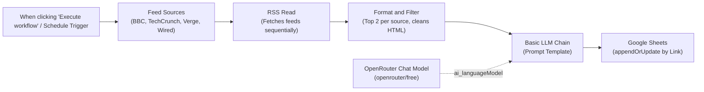

# n8n RSS Feed Summarizer: Multi-Source AI Summaries to Google Sheets

[](https://n8n.io/)
[](https://www.docker.com/)
[](https://openrouter.ai/)
[](https://workspace.google.com/products/sheets/)

An automated, production-ready n8n pipeline that monitors RSS feeds from leading technology publications (**BBC Technology**, **TechCrunch**, **The Verge**, and **Wired**), extracts the latest articles, summarizes them into 2 plain-English sentences using a free OpenRouter LLM, and logs the structured results into Google Sheets with automatic deduplication.

---

## 📑 Architecture Overview

### Multi-Source Pipeline Flow



### Why Multi-Source & Deduplication?
- **Single-Source Limitation**: Running a single feed (e.g. BBC Tech) repeatedly with a static `Limit 5` node returns the same 5 top articles whenever the publisher hasn't published new stories.
- **Balanced Multi-Source Ingestion**: The `Feed Sources` and `Format and Filter` nodes ingest 4 premier publications and extract the latest 2 articles per source (8 curated stories total per run).
- **Intelligent Deduplication**: The Google Sheets node utilizes `appendOrUpdate` matched on the article's canonical `Link`. If an article was already logged in an earlier run, it updates the existing entry instead of adding duplicate rows.

---

## 🗂️ Included Workflow Variants

| Workflow File | Mode | Sources | Trigger | Action |
| :--- | :--- | :--- | :--- | :--- |
| `workflows/rss-summarizer-multi.json` | **Multi-Source** | BBC Tech, TechCrunch, The Verge, Wired | Manual | Ingests 4 sources, 2 per source, deduplicates |
| `workflows/rss-summarizer-multi-scheduled.json` | **Multi-Source** | BBC Tech, TechCrunch, The Verge, Wired | Daily at 08:00 | Automated daily briefing into Google Sheets |
| `workflows/rss-summarizer.json` | **Single-Source** | BBC News Technology | Manual | Classic 6-node exercise implementation |
| `workflows/rss-summarizer-scheduled.json` | **Single-Source** | BBC News Technology | Daily at 08:00 | Scheduled variant with deduplication |

---

## 🧩 Workflow Node Pipeline (Multi-Source)

1. **Trigger Node** (`n8n-nodes-base.manualTrigger` or `scheduleTrigger`, v1/v1.2):
   - Initiates on-demand runs from the n8n canvas or on a scheduled cron interval (e.g., daily at 08:00 AM).
2. **Feed Sources** (`n8n-nodes-base.code`, v2):
   - Emits an array of tech publication feeds:
     - **BBC Technology**: `https://feeds.bbci.co.uk/news/technology/rss.xml`
     - **TechCrunch**: `https://techcrunch.com/feed/`
     - **The Verge**: `https://www.theverge.com/rss/index.xml`
     - **Wired**: `https://www.wired.com/feed/rss`
3. **RSS Read** (`n8n-nodes-base.rssFeedRead`, v1.2):
   - Dynamically reads `={{ $json.url }}` for each incoming item and parses the XML stream into standardized article records.
4. **Format and Filter** (`n8n-nodes-base.code`, v2):
   - Identifies source publication by domain.
   - Restricts to the top 2 articles per publisher to prevent any single publisher from dominating the briefing.
   - Cleans HTML entities and trims descriptions to stay within LLM token windows.
5. **Basic LLM Chain** (`@n8n/n8n-nodes-langchain.chainLlm`, v1.9):
   - Sends the formatted article to the LLM with prompt:
     ```text
     =Summarize this article in 2 plain-English sentences. Highlight the main news impact.

     Source: {{ $json.source }}
     Title: {{ $json.title }}

     Content: {{ $json.contentSnippet }}
     ```
   - Equipped with retry rules (`retryOnFail: true`, `maxTries: 3`, `waitBetweenTries: 2000 ms`).
6. **OpenRouter Chat Model** (`@n8n/n8n-nodes-langchain.lmChatOpenRouter`, v1):
   - Connects as an `ai_languageModel` sub-node using OpenRouter's free tier (`openrouter/free`).
7. **Google Sheets** (`n8n-nodes-base.googleSheets`, v4.7):
   - Operation: `appendOrUpdate` matched on `Link`.
   - Structured columns in `Sheet1`:
     - **Source**: `={{ $('Format and Filter').item.json.source }}`
     - **Title**: `={{ $('Format and Filter').item.json.title }}`
     - **Link**: `={{ $('Format and Filter').item.json.link }}`
     - **Published**: `={{ $('Format and Filter').item.json.pubDate }}`
     - **Summary**: `={{ $json.text }}`

---

## 🐳 Starting n8n with Docker

### Option 1: Docker Compose (Recommended)
Use the included `docker-compose.yml`:

```bash
docker compose up -d
```

To view live container logs:
```bash
docker compose logs -f n8n
```

### Option 2: Docker CLI
```bash
docker run -d \
  --name n8n \
  -p 5678:5678 \
  -e TZ=Asia/Kolkata \
  -e GENERIC_TIMEZONE=Asia/Kolkata \
  -v n8n-class_n8n_data:/home/node/.n8n \
  docker.n8n.io/n8nio/n8n:latest
```

The web dashboard is immediately accessible at **[http://localhost:5678](http://localhost:5678)**. Persistent workflows and credentials are saved in the Docker volume `n8n-class_n8n_data`.

---

## 🚀 Importing Workflows into Docker

Run the provided automation script to import all workflows directly into the running n8n container:

```bash
chmod +x ./scripts/import-workflow.sh
./scripts/import-workflow.sh
```

To inspect currently loaded workflows:
```bash
docker exec n8n n8n list:workflow
```

---

## 🔑 Credential Setup

### 1. OpenRouter AI Credential
1. Create a free account and key at [openrouter.ai/keys](https://openrouter.ai/keys).
2. In n8n, create an **OpenRouter API** credential and enter your API key.
3. Attach this credential to the **OpenRouter Chat Model** node.

### 2. Google Sheets OAuth2 Setup
1. In the [Google Cloud Console](https://console.cloud.google.com/):
   - Enable both **Google Sheets API** and **Google Drive API** under *APIs & Services &rarr; Library*.
   - Under *OAuth consent screen*, set User Type to **External** and add your Google account under **Test users**.
   - Under *Credentials &rarr; Create Credentials &rarr; OAuth client ID*, select **Web application**.
   - Set **Authorized redirect URIs** to:
     ```text
     http://localhost:5678/rest/oauth2-credential/callback
     ```
2. In n8n, add a **Google Sheets OAuth2 API** credential with your Client ID and Client Secret, click **Sign in with Google**, and approve access.
3. In [Google Sheets](https://sheets.new), ensure your spreadsheet named **`RSS Summaries`** has these row 1 headers:
   `Source | Title | Link | Published | Summary`.

---

## 🏃 Running & Verifying

### Run via Web Canvas
1. Open [http://localhost:5678](http://localhost:5678).
2. Select **RSS Summarizer (Multi-Source)**.
3. Click **Execute workflow** at the bottom of the canvas.
4. Each node will turn green in sequence as it fetches feeds, summarizes articles, and updates Google Sheets.

### Run via Terminal CLI
```bash
docker exec -e N8N_RUNNERS_BROKER_PORT=5689 n8n n8n execute --id=shY8hRfrlFmK2Suq
```

### Verified Sample Output in Google Sheets

| Source | Title | Published | Summary |
| :--- | :--- | :--- | :--- |
| **BBC Tech** | UK to invest £100m in 'world first' AI Biosecurity Lab | Sat, 24 Oct 2026 | The UK government plans to spend £100 million on a new laboratory that uses AI to protect against biological threats. |
| **TechCrunch** | AI delivers ‘zero financial payoff’ to most companies | Sun, 25 Oct 2026 | Despite massive investment, artificial intelligence has provided no financial benefit to most US companies outside tech. |
| **The Verge** | Now you can watch Instagram Reels on your Apple TV | Sun, 25 Oct 2026 | Instagram has launched a dedicated TV app on Apple TV, bringing Reels and live streams to living room screens. |
| **Wired** | Scientists Trapped an Antimatter Particle for Months | Sun, 25 Oct 2026 | Researchers held an antimatter particle for months, enabling breakthroughs in understanding why matter dominates the universe. |

---

## 🛠️ Troubleshooting Matrix

| Problem | Likely Cause | Solution |
| :--- | :--- | :--- |
| **Why does single feed return same 5 items?** | Publisher hasn't published new articles since last run. | Use `rss-summarizer-multi.json` for multi-source ingestion and deduplication. |
| **Error 403: access_denied** | Email not in Google Cloud Test Users list. | Add your Google account under Google Cloud Console &rarr; OAuth consent screen &rarr; Test users. |
| **Redirect URI mismatch** | Callback URI does not match Google Cloud config. | Ensure redirect URI is exactly `http://localhost:5678/rest/oauth2-credential/callback`. |
| **Google Drive / Sheets API Disabled** | Required APIs not activated in project. | Enable **Google Drive API** and **Google Sheets API** in Google Cloud Library. |
| **Summary column is empty** | Mapped incorrectly to RSS fields. | Map Summary to `{{ $json.text }}` (the output of Basic LLM Chain). |
| **columns.schema required** | n8n 4.4+ requires schema metadata. | Workflow JSON already includes column schema array matching the sheet headers. |
| **OpenRouter 429 Rate Limit** | Free model peak usage exceeded. | Node settings automatically retry up to 3 times with a 2000 ms backoff. |

---

## 📂 Repository Structure

```text
├── docker-compose.yml                                  # Docker Compose deployment configuration
├── README.md                                           # Comprehensive project documentation
├── SETUP.md                                            # Step-by-step credentials walkthrough
├── docs/
│   ├── DOCKER_GUIDE.md                                 # Dedicated Docker operations guide
│   └── RSS_Summarizer_Guide.pdf                        # Printable PDF documentation
├── scripts/
│   └── import-workflow.sh                              # Automated workflow container import script
├── workflows/
│   ├── rss-summarizer-multi.json                       # Multi-source workflow (BBC, TC, Verge, Wired)
│   ├── rss-summarizer-multi-scheduled.json             # Multi-source scheduled daily variant
│   ├── rss-summarizer.json                             # Single-source BBC Tech baseline workflow
│   └── rss-summarizer-scheduled.json                   # Single-source scheduled baseline workflow
├── .env.example                                        # Template for environment variables
└── .gitignore                                          # Ignores sensitive keys, credentials, and logs
```

---

## 📄 Documentation Links
- [Docker & Operations Guide](docs/DOCKER_GUIDE.md)
- [Credentials & Setup Walkthrough](SETUP.md)
- [Downloadable PDF Documentation](docs/RSS_Summarizer_Guide.pdf)
