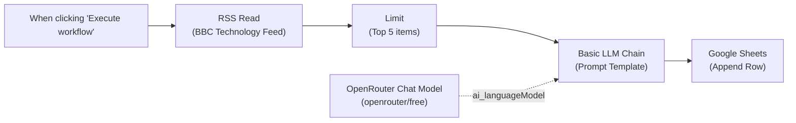

# n8n RSS Feed Summarizer: AI Summaries to Google Sheets

[](https://n8n.io/)
[](https://www.docker.com/)
[](https://openrouter.ai/)
[](https://workspace.google.com/products/sheets/)

An automated, production-ready n8n automation workflow that polls an RSS feed (BBC News Technology), extracts the latest articles, generates concise 2-sentence plain-English summaries using a free OpenRouter Large Language Model, and automatically logs the structured results into Google Sheets.

---

## 📑 Architecture Overview



### Workflow Node Pipeline

1. **Trigger Node** (`n8n-nodes-base.manualTrigger`, v1):
   - Initiates on-demand runs from the n8n canvas (or Schedule Trigger daily at `08:00` in the scheduled variant).
2. **RSS Read** (`n8n-nodes-base.rssFeedRead`, v1.2):
   - Queries `https://feeds.bbci.co.uk/news/technology/rss.xml` and parses XML into JSON items containing `title`, `link`, `pubDate`, and `contentSnippet`.
3. **Limit** (`n8n-nodes-base.limit`, v1):
   - Keeps test runs fast and stays within free-tier AI rate limits by filtering to `maxItems: 5`.
4. **Basic LLM Chain** (`@n8n/n8n-nodes-langchain.chainLlm`, v1.9):
   - Dynamically formats the prompt expression:
     ```text
     =Summarize this article in 2 plain-English sentences.

     Title: {{ $json.title }}

     Content: {{ $json.contentSnippet }}
     ```
   - Pre-configured with automatic retries (`retryOnFail: true`, `maxTries: 3`, `waitBetweenTries: 2000 ms`) and `onError: "continueRegularOutput"`.
5. **OpenRouter Chat Model** (`@n8n/n8n-nodes-langchain.lmChatOpenRouter`, v1):
   - Connects as an `ai_languageModel` sub-node using `openrouter/free` (or any `:free` model ID).
6. **Google Sheets** (`n8n-nodes-base.googleSheets`, v4.7):
   - Operation: `Append Row` (or `Append or Update Row` on `Link` for the scheduled variant).
   - Maps 4 columns into `Sheet1`:
     - **Title**: `={{ $('RSS Read').item.json.title }}`
     - **Link**: `={{ $('RSS Read').item.json.link }}`
     - **Published**: `={{ $('RSS Read').item.json.pubDate }}`
     - **Summary**: `={{ $json.text }}`

---

## 🐳 Starting n8n with Docker

### Option 1: Docker Compose (Recommended)
Use the included `docker-compose.yml`:

```bash
docker compose up -d
```

To view live container logs:
```bash
docker compose logs -f n8n
```

### Option 2: Docker CLI
```bash
docker run -d \
  --name n8n \
  -p 5678:5678 \
  -e TZ=Asia/Kolkata \
  -e GENERIC_TIMEZONE=Asia/Kolkata \
  -v n8n-class_n8n_data:/home/node/.n8n \
  docker.n8n.io/n8nio/n8n:latest
```

The web dashboard is immediately accessible at **[http://localhost:5678](http://localhost:5678)**. Persistent workflow and credential data are saved in the Docker volume `n8n-class_n8n_data`.

---

## 🚀 Importing the Workflow

Run the provided automation script to import the workflow directly into the running container:

```bash
chmod +x ./scripts/import-workflow.sh
./scripts/import-workflow.sh
```

To verify the workflow is loaded:
```bash
docker exec n8n n8n list:workflow
```

---

## 🔑 Credential Setup

### 1. OpenRouter AI
1. Create a free account and key at [openrouter.ai/keys](https://openrouter.ai/keys).
2. In n8n, create an **OpenRouter API** credential and enter your API key.
3. Attach this credential to the **OpenRouter Chat Model** sub-node.

### 2. Google Sheets OAuth2 Setup
1. In the [Google Cloud Console](https://console.cloud.google.com/):
   - Enable both **Google Sheets API** and **Google Drive API** under *APIs & Services &rarr; Library*.
   - Under *OAuth consent screen*, set User Type to **External** and add your Google account to **Test users**.
   - Under *Credentials &rarr; Create Credentials &rarr; OAuth client ID*, select **Web application**.
   - Set **Authorized redirect URIs** to:
     ```text
     http://localhost:5678/rest/oauth2-credential/callback
     ```
2. In n8n, add a **Google Sheets OAuth2 API** credential with your Client ID and Client Secret, click **Sign in with Google**, and approve access.
3. In [Google Sheets](https://sheets.new), create a sheet named **`RSS Summaries`** with row 1 headers:
   `Title | Link | Published | Summary`.
4. Select `RSS Summaries` in the Google Sheets node.

---

## 🏃 Running & Verifying

### Run via Web Canvas
1. Open [http://localhost:5678/workflow/jSTdUWRulww8JA2H](http://localhost:5678/workflow/jSTdUWRulww8JA2H).
2. Click **Execute workflow** at the bottom of the canvas.
3. All nodes will turn green, indicating success.

### Run via Terminal CLI
```bash
docker exec -e N8N_RUNNERS_BROKER_PORT=5689 n8n n8n execute --id=jSTdUWRulww8JA2H
```

### Verified Sample Output

```json
[
  {
    "Title": "UK to invest £100m in 'world first' AI Biosecurity Lab",
    "Link": "https://www.bbc.co.uk/news/articles/cqdjv8xllvyyo?at_medium=RSS&at_campaign=rss",
    "Published": "Sat, 24 Oct 2026 00:05:45 GMT",
    "Summary": "The UK government plans to spend £100 million on a new 'world-first' laboratory that uses artificial intelligence to protect against biological threats. Chancellor Jeremy Hunt will announce the funding as part of Wednesday's Budget to strengthen the country's defences."
  }
]
```

---

## 🛠️ Troubleshooting Matrix

| Problem | Likely Cause | Solution |
| :--- | :--- | :--- |
| **Error 403: access_denied** | Email not in Google Cloud Test Users list. | Add your Google account under Google Cloud Console &rarr; OAuth consent screen &rarr; Test users. |
| **Redirect URI mismatch** | Callback URI does not match Google Cloud config. | Ensure redirect URI is exactly `http://localhost:5678/rest/oauth2-credential/callback`. |
| **Google Drive / Sheets API Disabled** | Required APIs not activated in project. | Enable **Google Drive API** and **Google Sheets API** in Google Cloud Library. |
| **Summary column is empty** | Mapped incorrectly to RSS fields. | Map Summary to `{{ $json.text }}` (the output of Basic LLM Chain). |
| **columns.schema required** | n8n 4.4+ requires schema metadata. | Workflow JSON already includes column schema array matching the sheet headers. |
| **OpenRouter 429 Rate Limit** | Free model peak usage exceeded. | Node settings automatically retry up to 3 times with a 2000 ms backoff. |

---

## 📂 Repository Structure

```text
├── docker-compose.yml                     # Docker Compose deployment configuration
├── README.md                              # Detailed project documentation
├── SETUP.md                               # Step-by-step credentials walkthrough
├── docs/
│   ├── DOCKER_GUIDE.md                    # Dedicated Docker operations guide
│   └── RSS_Summarizer_Guide.pdf           # Printable PDF documentation
├── scripts/
│   └── import-workflow.sh                 # Workflow container import script
├── workflows/
│   ├── rss-summarizer.json                # Main workflow definition
│   └── rss-summarizer-scheduled.json      # Scheduled & deduplicated workflow variant
├── .env.example                           # Template for environment variables
└── .gitignore                             # Ignores sensitive keys, credentials, and logs
```

---

## 📄 Documentation Links
- [Docker & Operations Guide](docs/DOCKER_GUIDE.md)
- [Credentials & Setup Walkthrough](SETUP.md)
- [Downloadable PDF Documentation](docs/RSS_Summarizer_Guide.pdf)
